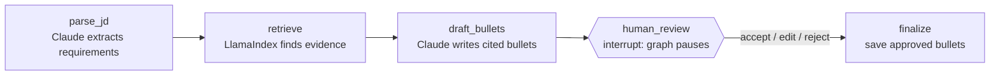
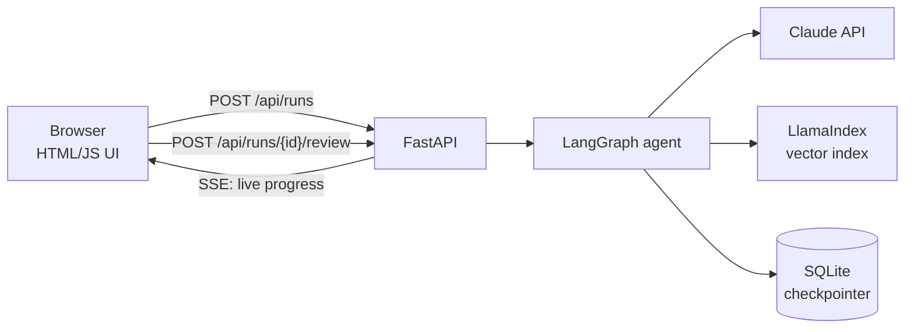

# Resume Tailor AI Agent

A human-in-the-loop AI agent that tailors resume bullets to a specific job description, using **only facts from your real experience**.

**Live demo:** https://resume-tailor-ai-agent.onrender.com (Username: daniel, and password: ak157179)

Paste a job posting → the agent extracts what the employer wants → retrieves matching evidence from your experience files → Claude drafts bullets that cite their sources → **you approve, edit, or reject each one** before anything is saved.

Built with **LangGraph**, **LangChain**, **LlamaIndex**, the **Anthropic API (Claude)**, and **FastAPI** with **Server-Sent Events** for live progress.

<!-- Add screenshots: save them in docs/ and uncomment


-->

---

## Why this project

Tailoring a resume for every application is slow, and generic AI rewriting tools tend to **invent** skills, numbers, and tools. This agent is designed around two ideas:

1. **Grounding:** every drafted bullet must cite the evidence chunks it came from. Bullets without valid citations are dropped automatically.
2. **Human control:** the workflow pauses before saving so a person reviews every bullet. Nothing reaches the final output without approval.

In testing, when a job asked for tools that weren't in the experience files (e.g. Pinecone, Chroma), the agent skipped those requirements instead of fabricating experience.

---

## Architecture

### Agent workflow (LangGraph)



| Node | What it does | Tech |
|---|---|---|
| `parse_jd` | Extracts the 5–8 key requirements from the job description as structured output | Claude via LangChain (`with_structured_output`) |
| `retrieve` | Finds the experience chunks that best match each requirement | LlamaIndex vector index + local `bge-small-en-v1.5` embeddings |
| `draft_bullets` | Writes tailored bullets, each citing evidence IDs; uncited bullets are filtered out | Claude via a LangChain prompt chain |
| `human_review` | Pauses the graph and waits for human decisions | LangGraph `interrupt()` |
| `finalize` | Writes approved bullets (with requirement + source file) to Markdown | Python |

### System



### How human-in-the-loop works

- When the graph reaches `human_review`, LangGraph's `interrupt()` **pauses execution** and the full state is saved by a **SQLite checkpointer**.
- The paused run is identified by a `thread_id`, so the review can happen in a later HTTP request, even after a server restart.
- The UI sends the decisions back and the graph **resumes** with `Command(resume=decisions)`, then runs `finalize`.

---

## Tech stack

| Layer | Tools |
|---|---|
| LLM | Anthropic Claude (`claude-sonnet-5-5`) |
| Orchestration | LangGraph (state graph, `interrupt`, SQLite checkpointer) |
| LLM framework | LangChain (`ChatAnthropic`, prompt templates, structured output) |
| Retrieval | LlamaIndex (`VectorStoreIndex`, Markdown node parser) + Hugging Face embeddings |
| Backend | FastAPI, Server-Sent Events (streaming progress) |
| Frontend | Plain HTML/CSS/JavaScript (`EventSource` for SSE) |

---

## Project structure

```
resume-tailor/
├── src/
│   ├── index.py        # LlamaIndex: build/load the vector index over data/experience
│   ├── graph.py        # LangGraph workflow (nodes, prompts, guardrails, checkpointer)
│   └── api.py          # FastAPI backend + SSE streaming
├── static/
│   └── index.html      # Web UI: paste JD, live progress, review cards
├── data/
│   ├── experience/     # One Markdown file per job, project, skills, education
│   └── jobs/jd.txt     # A target job description
├── main.py             # CLI version of the review flow
├── test_graph.py       # End-to-end smoke test (scripted human decisions)
├── setup_data.py       # Generates the experience files
├── requirements.txt
└── .env.example
```

---

## Getting started

**Requirements:** Python 3.10+ and an [Anthropic API key](https://console.anthropic.com).

```bash
git clone https://github.com/Dan-Ak26/resume-tailor-AI-Agent.git
cd resume-tailor-AI-Agent
python -m venv .venv

# Windows (PowerShell)
.\.venv\Scripts\Activate.ps1
# macOS / Linux
source .venv/bin/activate

pip install -r requirements.txt
```

Copy `.env.example` to `.env` and add your key:

```
ANTHROPIC_API_KEY=sk-ant-...
```

### Add your experience

Replace the files in `data/experience/` with your own: one Markdown file per job or project. Use `#`/`##` headings for each role or accomplishment and include concrete details (tools, scale, metrics). The agent can only use what's in these files.

Then build the index:

```bash
python src/index.py
```

Re-run this whenever you edit your experience files.

### Run the web app

```bash
uvicorn src.api:app --reload
```

Open **http://127.0.0.1:8000**, paste a job description, and click **Tailor my resume**.

### Or use the CLI

```bash
python main.py   # reads data/jobs/jd.txt, review bullets in the terminal
```

### Run the test

```bash
python test_graph.py
```

Runs the full graph, pauses at review, resumes with scripted decisions (accept / edit / reject), and checks that the output reflects them.

---

## API

| Method | Endpoint | Description |
|---|---|---|
| `POST` | `/api/runs` | Start a run. Body: `{"jd": "..."}` → `{"run_id": "..."}` |
| `GET` | `/api/runs/{run_id}/stream` | SSE stream: `progress` events per node, then a `review` event with drafted bullets |
| `POST` | `/api/runs/{run_id}/review` | Body: `{"decisions": [{"action": "accept" \| "edit" \| "reject", "text": "..."}]}` → approved bullets |
| `GET` | `/api/sample-jd` | Returns `data/jobs/jd.txt` |

Interactive docs are at **http://127.0.0.1:8000/docs**.

---

## Roadmap

- [ ] Swap the in-memory vector store for **Chroma** or **pgvector**
- [ ] Evaluation suite: grounding rate, duplicate rate, and acceptance rate across multiple job postings
- [ ] Export a full tailored resume (`.docx` / PDF)
- [ ] Dockerfile and deployment to Render
- [ ] Authentication and rate limiting for a hosted version

---

## Author

**Daniel Aklilu** 
